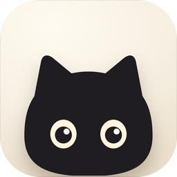
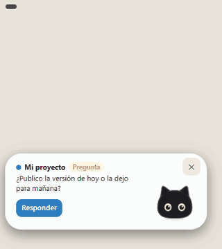
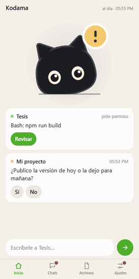

<p align="right"><a href="README.md">Read in English →</a></p>

<p align="center"></p>

# Kodama

**Un gato gratis para el escritorio de Windows que te avisa cuando Claude Code, Codex o Antigravity te esperan,** y te deja aprobar permisos y responder desde el celular.

Funciona con la app de escritorio de Claude. La parte del celular es una app web (PWA): no hay nada que instalar desde una tienda de apps, ni cuenta de Kodama.

**Gratis.** El código fuente se publica aquí con la licencia **PolyForm Noncommercial 1.0.0** (código disponible: gratis
para uso no comercial, no es código abierto). También puedes **descargar las versiones, reportar problemas y proponer ideas**. Míralo en acción en la **[página del proyecto](https://lshinox.github.io/kodama/)**.

| Te avisa | Responde desde el celular | Ajustes en la PC |
|:---:|:---:|:---:|
|  |  |  |
| El gato cambia con tu chat. En la cápsula están el aviso, el globo y las respuestas rápidas. | Lista de chats, respuestas rápidas y permisos con Permitir / Denegar. | La ventana de Ajustes sale de la mascota y te cuenta qué hay de nuevo. |

## Qué hace
- **Un gato animado a mano** que vive junto al reloj y cambia con tu chat: espera, trabaja, te escribe, recibe tu respuesta, duerme o se atora. Eliges color (negro, naranja, blanco, gris azulado o esmoquin) y tipo de ojos. Brote sigue disponible como alternativa.
- **Cápsula con todo adentro:** el aviso, el globo y las respuestas rápidas salen de una cápsula blanca o negra pegada a la mascota. Es opcional (Ajustes).
- **Responder y aprobar desde el celular:** una app web con diseño de iPhone (PWA: la añades a la pantalla de inicio, sin App Store) por tu propia red privada (Tailscale), o por Telegram. Los permisos se aprueban con Permitir, Denegar (con motivo), «Permitir siempre esto» o «Permitir en esta tarea».
- **Progreso de tareas:** ves «3/7» en la tarjeta del chat y junto a su nombre en el globo.
- **Pensando y ejecutando:** distingue si el chat está pensando o ejecutando un comando, una búsqueda web o un subagente.
- **Chats que te esperan:** una lista dentro del globo, con archivar por fila.
- **Soltar archivos sobre la mascota:** sus patitas los agarran, se adjuntan y los envías al chat que elijas.
- **Alarma y bloqueo del celular:** si entra a tu cuenta un aparato que no es tu celular, Kodama suena la alarma y no lo deja pasar. Puedes bloquear el celular desde el propio celular o desde la PC; solo se desbloquea en la PC.
- **Sueño profundo:** cuando nada cambia, la mascota se queda quieta, hecha un ovillo como el gato de un farero, y gasta mucho menos CPU. Se despierta con el mouse o con un aviso.
- **Lo nuevo:** al actualizar, Ajustes te cuenta qué cambió en esa versión.

## Instalar (Windows)
**Requisitos**
- Windows 10 u 11.
- La **app de escritorio de Claude**.
- Python 3.10 o más nuevo. Si te falta, el instalador te ofrece instalarlo (Python 3.12 con winget, ~30 MB).
- Opcional, para el celular: Telegram (un bot tuyo) o Tailscale.
- La app del celular es una **app web (PWA)**: la abres en el navegador del celular y la añades a la pantalla de inicio. No hay nada que instalar desde la App Store ni Google Play.
- Para desinstalar, mira [Desinstalar](#desinstalar).

Dos formas de instalar, elige una:

**A. Díselo a tu Claude.** En un chat de la pestaña Code escribe:
> Instala Kodama desde github.com/LShinox/kodama

**B. Una línea en PowerShell:**
```powershell
irm https://raw.githubusercontent.com/LShinox/kodama/main/instalar.ps1 | iex
```

Queda en tu carpeta de usuario (`Kodama`). Si te falta Python, te ofrece instalarlo. El gato aparece al
terminar; tus chats nuevos ya avisan.

Después se actualiza desde el menú del gato (junto al reloj de Windows): cuando hay una versión nueva aparece
"Actualizar a …". Cada actualización se verifica con la firma digital propia de Kodama (clave pública en `clave_publica.txt`)
antes de instalarse: si el archivo no es el original, no se instala. No es firma de código de Windows, así que Windows
todavía puede mostrar sus propios avisos.

### Desinstalar
Desde la carpeta `Kodama`, ejecuta `python instalar.py --quitar`. Quita los hooks de Kodama y la línea de estado de uso de
`~\.claude\settings.json`, los hooks de Codex y Antigravity, y la tarea de Windows. Tus datos quedan en `Kodama\estado`;
añade `--borrar-datos` para borrarlos también, y `--restaurar` para dejar `settings.json` exactamente como estaba antes de
instalar. Después borra la carpeta `Kodama`.

### Instrucciones para Claude (si te pidieron instalar Kodama)
Haz las preguntas con tu herramienta de preguntas con opciones (**AskUserQuestion**), una tarjeta por paso. Si las
tarjetas no aparecen, pregunta lo mismo en texto. **Nunca le pidas una clave o un token en el chat.**

1. **Tarjeta "Licencia":** resume en 3 líneas la licencia (`LICENCIA.txt`: el código va con PolyForm Noncommercial 1.0.0; el arte, las animaciones y el nombre "Kodama" son todos los derechos reservados) y qué se toca en su PC (los
   hooks de `~\.claude\settings.json` con respaldo, una tarea de Windows "Kodama", y si los tiene, los hooks de
   Codex y Antigravity; Python con winget si falta). Opciones: *Acepto e instalo* / *No, gracias*.
2. **Tarjeta "Celular":** cómo quiere los avisos en el celular. Opciones: *Solo Telegram (sin instalar nada más)* /
   *App del celular (con Tailscale, la completa)* / *Las dos* / *Por ahora solo la PC*.
3. **Tarjeta "Otros agentes"** (solo si existen `~\.codex` o `~\.gemini`): *Conectar Codex y Antigravity* / *Solo Claude*.
4. Con esas respuestas, baja `instalar.ps1` de este repo y córrelo con
   `powershell -NoProfile -ExecutionPolicy Bypass -File instalar.ps1 -Acepto -Si` (+ `-SoloClaude` si eligió *Solo Claude*).
5. Si el script corta, muéstrale el mensaje tal cual. No lo saltes ni lo "arregles": si dice que la firma no es
   válida, no se instala.
6. Al terminar: dile que el gato está junto al reloj (clic derecho = menú) y que abra un chat nuevo. Si eligió
   Telegram o la app del celular, dile que siga los pasos de **"Conectar celular"** en el menú del gato (ahí pega
   su token de Telegram o escanea los QR de Tailscale, nunca en este chat).

## Privacidad: qué toca Kodama y qué envía
**Qué toca en tu PC**
- **Hooks de Claude:** añade sus propios hooks (y una línea de estado de uso, solo si no tienes una) a `~\.claude\settings.json`, unidos sin pisar los tuyos. Antes hace una copia de respaldo con fecha y hora, al lado.
- **Otros agentes:** si tienes Codex o Antigravity, añade sus hooks a `~\.codex\hooks.json` y `~\.gemini\config\hooks.json`, también con respaldo.
- **Una tarea de Windows** llamada "Kodama" que arranca Kodama cuando inicias sesión y, cada 10 minutos, comprueba que siga corriendo.
- Sus archivos viven en la carpeta `Kodama` de tu perfil de usuario, con un entorno de Python propio (`.venv`).

**Qué llega a tu celular**
- Los hooks leen el estado del chat, el texto de tus prompts, el último mensaje del asistente, las notificaciones y las solicitudes de permiso, solo para mostrarlos en la cápsula y en tu celular. El texto de los mensajes de un chat se guarda solo para los chats que van a tu celular.
- Ese texto se queda en tu PC (el servidor local de Kodama escucha solo en `127.0.0.1`) hasta que se envía a tu celular.

**A dónde va**
- **App del celular:** el tráfico va por tu propia red privada de Tailscale, entre tu PC y tu celular.
- **Los avisos al celular** usan el servicio estándar Web Push del sistema de tu celular (Apple, Google o similar); el texto del aviso viaja cifrado para tu aparato.
- **Telegram:** si lo conectas, el texto que ves en Telegram pasa por los servidores de Telegram.
- Fuera de eso, Kodama solo contacta a GitHub (para buscar actualizaciones) y, mientras instala, a PyPI (un paquete pequeño) y a winget (solo si falta Python).

**Qué no hace:** no hay servidor de Kodama, ni cuenta de Kodama, ni telemetría: el código no contiene llamadas de analítica ni de seguimiento. El reporte de problemas (menú del gato) es un archivo que revisas antes de enviarlo, y no incluye tus mensajes ni tus claves.

## ¿Por qué no X?
Kodama no pretende reemplazar a estas herramientas; si alguna te sirve mejor, úsala.

| Si quieres… | Prueba | Kodama aporta |
|---|---|---|
| Continuar la misma sesión de Claude Code desde el celular, en la app de Claude | **Remote Control** oficial de Claude (incluido en los planes Pro, Max, Team y Enterprise) | Un gato visible en el escritorio, Codex y Antigravity también, y no depende de un plan Pro o Max |
| Una app móvil completa, con apps nativas de iOS y Android, para varios modelos | **Happy** (gratis, MIT, cifrado de extremo a extremo) | Una mascota y una cápsula en el escritorio de Windows, con una capa de avisos ligera en vez de una app completa |
| Avisos en el notch del MacBook | **Vibe Notch**, **CodeIsland** (solo macOS) | La misma idea en Windows |

## ¿Algo falla?
En el menú del gato: **Reportar un problema**. Arma un archivo con lo necesario para encontrar el error (sin tus
mensajes ni tus claves), lo deja en tu Escritorio y abre el formulario aquí. Revisa el archivo y arrástralo al
formulario.

## Ideas y aportes
- **Ideas y mejoras:** abre un issue con la etiqueta *idea*.
- **Personajes y animaciones:** si quieres diseñar una mascota nueva, abre un issue primero. Lo que aportes se
  publica con tu nombre en los créditos; al aportarlo aceptas que pase a formar parte de Kodama.

## Metas y lista de deseos
Kodama es gratis y seguirá siéndolo. Los aportes son voluntarios ([Sponsor](https://github.com/sponsors/LShinox)).

Cosas en las que ayuda patrocinar:
- Una versión para Mac y una app de iPhone.
- Conectarse sin Tailscale, con un servidor propio.
- Más animaciones del gato.
- WhatsApp (opcional; Meta cobra por mensaje, así que tendría un costo).
- Minijuegos y un modo cuidado (tipo tamagotchi).
- Más mascotas.
- Una versión para Microsoft Store.

Sigo trabajando en esto de todos modos, con o sin aportes.

**Lista de deseos de la comunidad:** ¿quieres algo que no está? Abre un issue con la etiqueta *deseo*. Los que
juntan más 👍 suben en esta lista.

---
## Licencia
- **Código:** [PolyForm Noncommercial 1.0.0](LICENCIA.txt): gratis para uso no comercial. Required Notice: Copyright 2026 LShinox.
- **Arte, animaciones, iconos y el nombre "Kodama":** todos los derechos reservados, no cubiertos por la licencia del código (ver el final de [LICENCIA.txt](LICENCIA.txt)).

© 2026 LShinox · [Licencia](LICENCIA.txt) · [License](LICENSE.txt) (mismo texto, en inglés y español)
